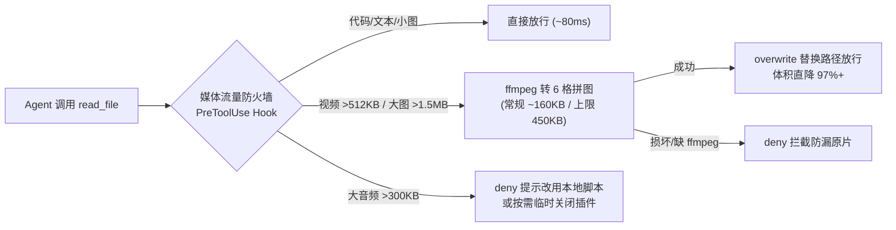

# antigravity-traffic-guard

[](https://github.com/zhangzhangwudi2-creator/antigravity-traffic-guard/actions/workflows/ci.yml)
[](LICENSE)
[](https://www.python.org/)
[](#安装方式)

**专治 Google Antigravity 后台偷跑 / 多模态长对话代理流量暴涨的双层防火墙：**
1. **插件层（防无状态重传雪球）**：通过 `PreToolUse` 钩子自动拦截主对话 `read_file` 读取大视频 / 音频 / 超大图，实时调用本地 `ffmpeg` 转成 6 格关键帧拼图（常规 `~160 KB`，硬上限 `450 KB`）后再放行，并在媒体缓存每累计 `15 MB` 时自动触发 `/compact` 提醒。
2. **网络层（防 Clearcut 遥测循环偷跑）**：提供开箱即用的 Clash Verge Rev / Mihomo 防漏配置模板，精准嗅探并 `REJECT` 后台 `play.googleapis.com/log` 遥测上报，零误杀正常 AI 对话接口。

[English Documentation](./README_EN.md)

---

## 为什么会一天烧掉几十 GB 代理流量？

实测抓包与日志排查发现，流量暴涨通常由**两层原因叠加**导致：

| 流量黑洞 | 实测异常数据 | 本项目如何拦截 |
| :--- | :--- | :--- |
| **1. `play.googleapis.com/log` 遥测死循环** | 代理抖动超时触发高频重传，单条连接 21 分钟上传 `134.5 MB`（下载仅 `0.19 MB`） | Clash `sniffer` 开启 `parse-pure-ip` + `QUIC: [443]`，配合全局 `Script.js` 原地 `REJECT` |
| **2. 主对话塞入大 `.mp4`/`.wav` 无状态重传** | 对话压缩只看 token 不看文件 MB；塞入 100 MB 视频后每步工具调用都在 Base64 重传，单日上传 **`20+ GB`** | `PreToolUse` 自动把 `7.18 MB` 视频压成 `162.8 KB` 拼图（**`-97.7%`**），音频强制隔离进一次性子代理 |



---

## 安装方式

### 1. 安装 Antigravity 大媒体防火墙插件（零后台常驻进程）

**前置要求**：Python 3.8+、`ffmpeg`（建议加入系统 `PATH`，或设置环境变量 `FFMPEG_PATH`）。

**Windows (PowerShell)：**
```powershell
git clone https://github.com/zhangzhangwudi2-creator/antigravity-traffic-guard.git
cd antigravity-traffic-guard
powershell -ExecutionPolicy Bypass -File .\install.ps1
```

**macOS / Linux：**
```bash
git clone https://github.com/zhangzhangwudi2-creator/antigravity-traffic-guard.git
cd antigravity-traffic-guard
chmod +x install.sh && ./install.sh
```

> 安装后会写入 `~/.gemini/config/plugins/media-traffic-guard/`，**新开对话立即生效**。卸载只需运行 `.\install.ps1 -Uninstall` 或 `./install.sh --uninstall`。

### 2. 配置 Clash Verge Rev 防遥测偷跑（可选但强烈推荐）
见 [clash-verge-templates/README.md](./clash-verge-templates/README.md)（包含解决 `Merge.yaml` 中 `prepend-rules` 不生效的关键踩坑说明）。

---

## 性能与可配置环境变量

* **零后台常驻开销**：仅在执行 `read_file` 或模型调用前瞬间触发，读普通代码耗时约 `80ms`，不影响游戏或日常性能。
* **可调阈值环境变量**：`MTG_VIDEO_KB`（默认 `512`）、`MTG_AUDIO_KB`（默认 `300`）、`MTG_IMAGE_KB`（默认 `1536`）、`MTG_WARN_MB`（默认 `15`）、`FFMPEG_PATH`。

## 推荐搭配的开源监控工具
* [severin-ye/mihomo-traffic-ledger](https://github.com/severin-ye/mihomo-traffic-ledger) — Windows 端 Clash Verge Rev 本地 SQLite 进程级流量账本，随时看清每个进程走了哪条节点。（注：`v1.1.0` 发布版建议按需打开查账、查完退出托盘，暂不建议 24 小时常驻后台，直至包含命名管道复用修复 `62e8e87` 的新版本发布。）

## 本地运行测试
```bash
python -m unittest discover -s tests -v
```
