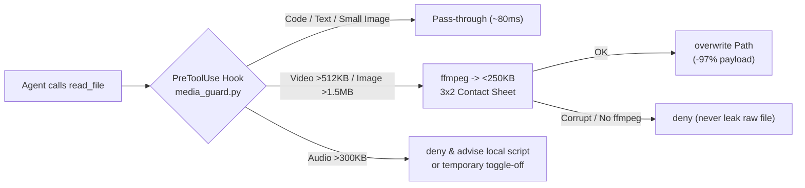

# antigravity-traffic-guard

[](LICENSE)
[](https://www.python.org/)
[](#installation)

**A two-layer bandwidth shield for Google Antigravity that stops background telemetry storms and stateless multimodal Base64 re-upload blowups.**

1. **Plugin Layer (`media-traffic-guard`)**: Intercepts `read_file` via Antigravity `PreToolUse` hooks, converts oversized videos/images on the fly with `ffmpeg` into `< 250 KB` 6-frame contact sheets, blocks raw large audio from entering the main thread, and triggers `/compact` alerts every `15 MB` of accumulated media cache.
2. **Proxy Layer (`clash-verge-templates`)**: Hardened Clash Verge Rev / Mihomo snippets enabling pure-IP + QUIC SNI sniffing and injecting `DOMAIN,play.googleapis.com,REJECT` via global `Script.js` without breaking core LLM endpoints.

[中文文档](./README.md)

---

## Why Does Bandwidth Spike by Tens of GBs?

| Root Cause | Observed Impact | Fix in This Repo |
| :--- | :--- | :--- |
| **1. `play.googleapis.com/log` retry storm** | Clearcut telemetry loops on flaky proxies (`134.5 MB` upload vs `0.19 MB` download in 21 min on one socket) | `Merge.sniffer.yaml` (`parse-pure-ip: true`, `QUIC: [443]`) + `Script.block-telemetry.js` (`REJECT`) |
| **2. Raw `.mp4`/`.wav` re-uploads in long chats** | Context compaction tracks token count, not MB size; holding `100+ MB` of raw MP4s re-uploads them on every tool step (`20+ GB/day`) | `PreToolUse` rewrites `7.18 MB` MP4 -> `162.8 KB` JPEG contact sheet (**`-97.7%`**); forces audio/deep review into disposable subagents |



---

## Installation

**Prerequisites**: Python 3.8+ and `ffmpeg` in `PATH` (or set `FFMPEG_PATH`).

**Windows (PowerShell):**
```powershell
git clone https://github.com/zhangzhangwudi2-creator/antigravity-traffic-guard.git
cd antigravity-traffic-guard
powershell -ExecutionPolicy Bypass -File .\install.ps1
```

**macOS / Linux:**
```bash
git clone https://github.com/zhangzhangwudi2-creator/antigravity-traffic-guard.git
cd antigravity-traffic-guard
chmod +x install.sh && ./install.sh
```

Start a new Antigravity conversation to activate. Uninstall anytime with `.\install.ps1 -Uninstall` or `./install.sh --uninstall`.

### Clash Verge Rev Anti-Telemetry Setup
See [clash-verge-templates/README.md](./clash-verge-templates/README.md) (explains why `prepend-rules:` in global `Merge.yaml` is ignored and why the rule must live in global `Script.js`).

---

## Performance & Configuration

* **Zero background daemon**: Fires only on `read_file` / `PreInvocation` (~`80 ms` passthrough for source files).
* **Optional env vars**: `MTG_VIDEO_KB` (`512`), `MTG_AUDIO_KB` (`300`), `MTG_IMAGE_KB` (`1536`), `MTG_WARN_MB` (`15`), `FFMPEG_PATH`.

## Companion Open-Source Monitor
* [severin-ye/mihomo-traffic-ledger](https://github.com/severin-ye/mihomo-traffic-ledger) — Local-first Windows per-process SQLite traffic ledger for Clash Verge Rev / Mihomo. (Note: `v1.1.0` release is best used on-demand and exited from the tray afterward rather than left running 24/7, until a release ships pipe-reuse fix `62e8e87`.)

## Run Tests
```bash
python -m unittest discover -s tests -v
```
